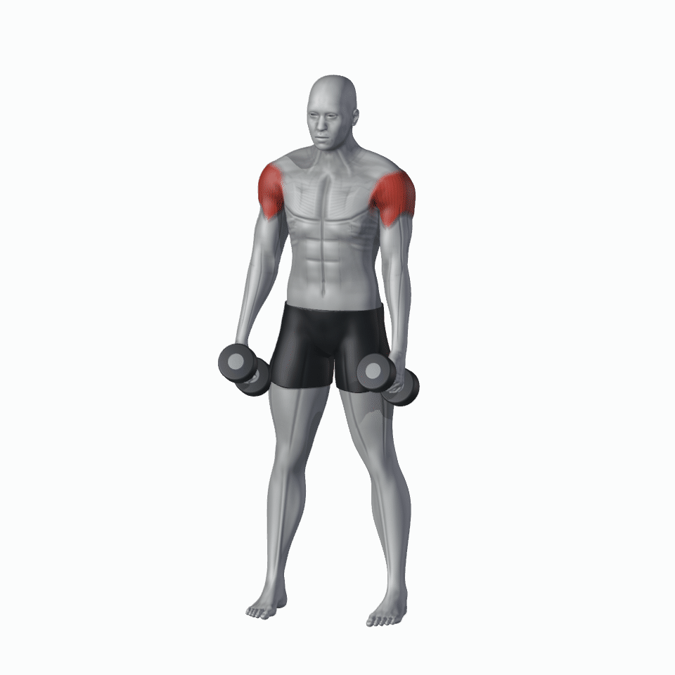
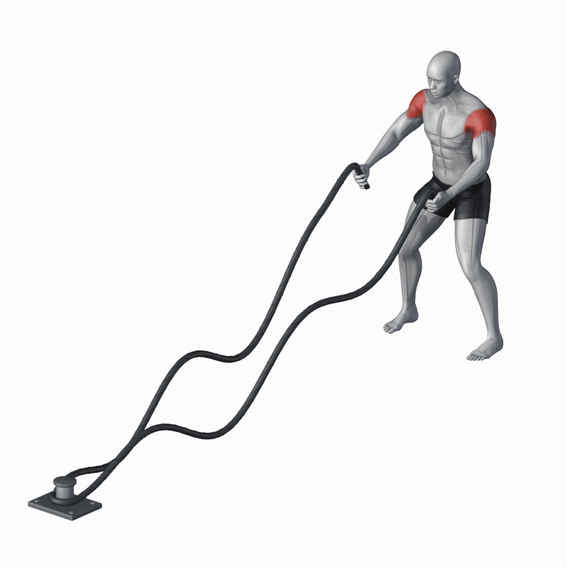
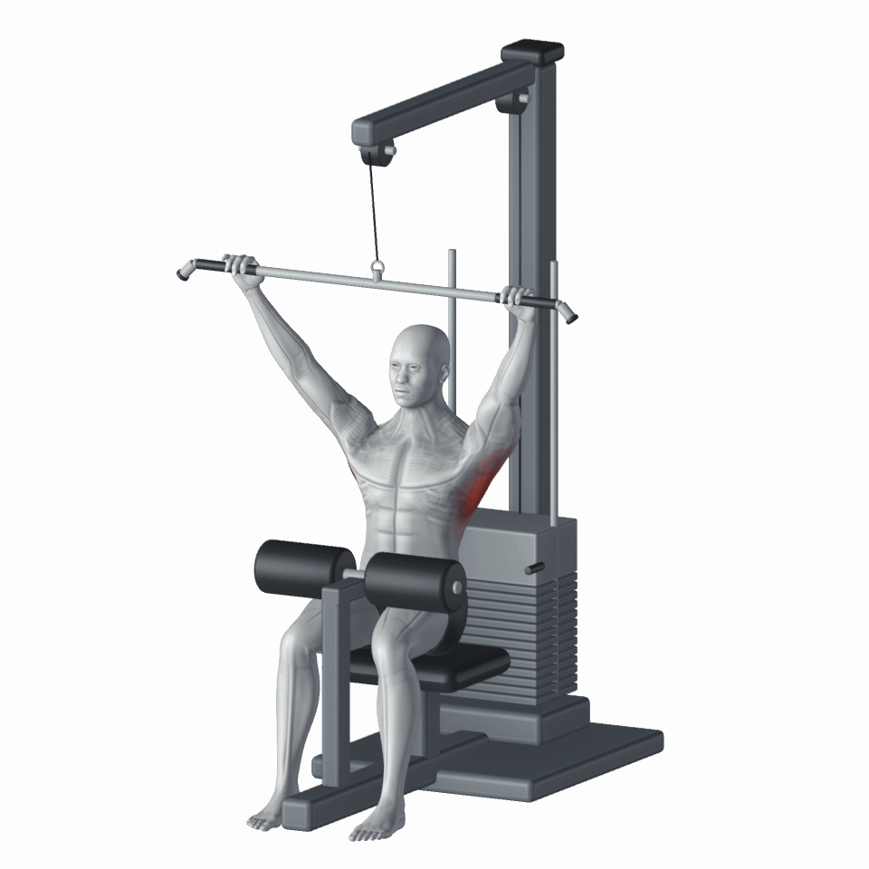
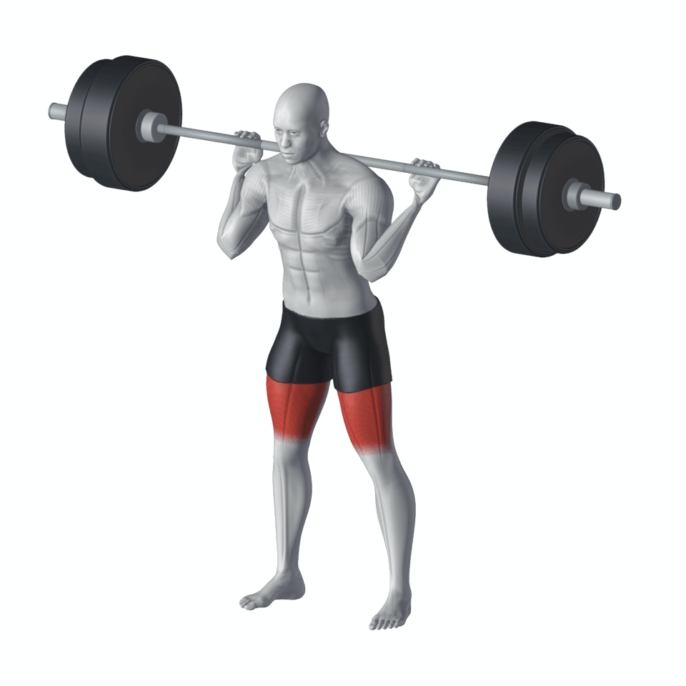

# Exercise Motion Blender Skill

以 Blender 建立有肌肉線條的連續蒙皮人體、器材與健身動作動畫。包含可重建的人體資產、動作範例、抓握檢查與 GIF 輸出流程。

## 生成成果

### 啞鈴側平舉


### 交替甩戰繩


### 坐姿寬握滑輪下拉


### 槓鈴背蹲


四個範例皆為 960×960，白底、完整人體、無圖片文字。側平舉 3 秒；戰繩、下拉與深蹲 4 秒循環。

## 快速開始

環境：Blender 4.3.2、Python 3。Python 依賴：Pillow、NumPy。

```bash
git clone https://github.com/susuky/exercise-motion-blender-skill.git
cd exercise-motion-blender-skill
python -m pip install -r requirements.txt
blender -b --python rebuild_human.py
```

最後一步從隨附基礎網格建立肌肉浮雕、肌束細紋、骨架蒙皮與有厚度的短褲，輸出 `assets/improved_human.blend`。這個高精度模型可供後續動作重用。

### 產生滑輪下拉

```bash
cd examples/lat_pulldown_xhigh
blender -b --python build_scene.py
blender -b --python scripts/render.py
python package.py
```

其他動作的命令見各範例 README。作為 AI skill 使用時，先讀根目錄 `SKILL.md`，再選擇相關範例與檢查規格。

## 檔案結構

- `SKILL.md`：動作製作流程與畫質基準
- `rebuild_human.py`：重建高精度人體
- `assets/`：基礎人體、授權與外觀參考
- `examples/xhigh/`：側平舉的完整建模流程
- `examples/battle_rope/`：繩索波浪、抓握與循環
- `examples/lat_pulldown_xhigh/`：器材、鋼索、配重及接觸檢查
- `references/`：人體、渲染與動作驗收說明
- `pipeline/`：動作規格、運動學與格式輸出工具
- `media/`：README 展示 GIF

## 人體與畫面

灰白連續人體表面、方向性肌束紋理、獨立黑色短褲；固定白底鏡頭，使用 Blender Workbench 渲染。手指沿握把圓柱求解，各動作另行設定肩、肘、腕和器材接觸。紅色標示由程序化區域遮罩產生，尚未建立完整解剖肌群分割。

## 驗證範圍

已製作與檢查的範例是上方四種動作。各範例附有相應的幾何檢查腳本或報告；新動作需要重新驗證接觸、關節、腳底及器材運動。舊 pipeline 的設備分類可用於描述與規劃，各類動作的可用性依個別實作確認。

## 資產授權

隨附基礎人體為 MPFB 衍生 CC0 資產，授權文字位於 `assets/LICENSE.ASSETS.md`。程式及衍生成果尚未指定專案整體開源授權。
